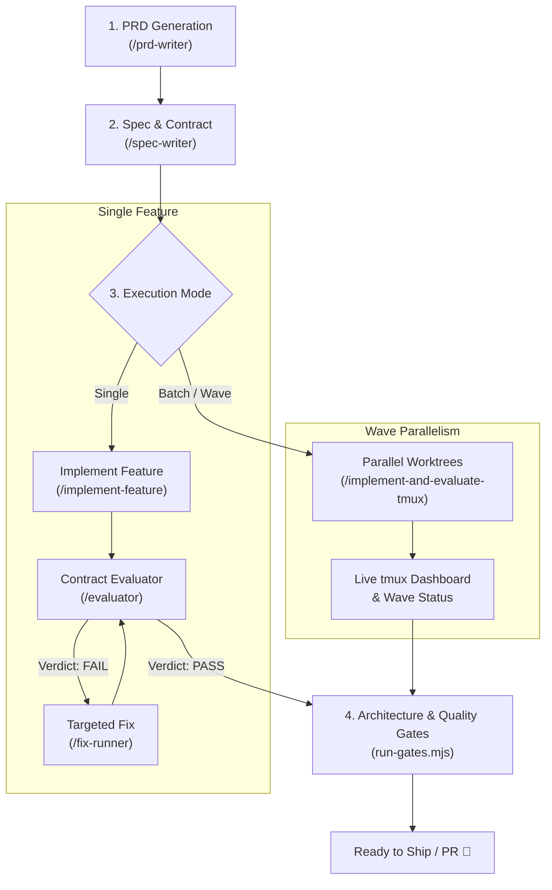

# 🚀 AI DevKit Harness

> **A production-ready harness and template for building robust software with autonomous and semi-autonomous AI agents.**  
> Enforces **Clean Architecture & Tactical DDD**, **Behavior-Driven Contracts**, **Automated Quality Gates**, and **Scalable Multi-Agent Orchestration**.

[](LICENSE)
[](.agents/skills/clean-arch/SKILL.md)
[](#-the-agent-development-lifecycle)

---

## 📖 Overview

**AI DevKit Harness** is an opinionated scaffold and agent capability kit designed to transform how software is designed, implemented, and verified using AI coding agents (such as Google Antigravity, Claude Code, Cursor, Windsurf, or Codex-based tools).

Instead of letting AI write untracked, unarchitected code that degrades quickly, this harness establishes:
1. **Deterministic Architecture**: Strict inward dependency rules separating Domain, Use Cases, and Infrastructure.
2. **Contract-Driven Quality**: Every feature is backed by a Given-When-Then behavioral contract (`contract.md`) verified by independent evaluator agents.
3. **Automated Quality Gates**: Architectural rule enforcement via `dependency-cruiser`, dead-code elimination via `knip`, type checking, and unit/integration test suites.
4. **Parallel Multi-Agent Execution**: Run entire feature waves concurrently across isolated Git worktrees and `tmux` sessions.
5. **Interactive Scaffolding**: Built-in CLI generator to bootstrap clean-architecture backends (Fastify, Prisma/PostgreSQL) and full-stack solutions (Next.js).

---

## 📂 Repository Structure

```
.
├── .agents/
│   ├── agents/
│   │   └── frontend-ui-design.md        # Specialist persona for modern, high-aesthetic UI/UX
│   ├── commands/
│   │   └── implement-and-evaluate-tmux.md # Command trigger for parallel wave execution
│   └── skills/
│       ├── clean-arch/                  # Clean Architecture & DDD guidelines, checks & scaffolders
│       │   ├── references/              # In-depth architectural patterns & anti-patterns
│       │   ├── scripts/                 # Scaffolding engine (scaffold.mjs) & quality runners
│       │   └── templates/               # Project templates (backend, db, web overlay)
│       ├── prd-writer/                  # 9-section structured PRD generation skill
│       ├── spec-writer/                 # Technical spec, plan & contract.md authoring
│       ├── implement-feature/           # Autonomous single-feature implementation
│       ├── evaluator/                   # Stack-agnostic behavioral contract verifier
│       ├── fix-runner/                  # Targeted corrective engine for failed evaluations
│       ├── implement-and-evaluate/      # Self-healing loop (implement -> evaluate -> fix)
│       └── implement-and-evaluate-tmux/ # Worktree + tmux parallel wave orchestrator
└── README.md
```

---

## 🛠️ The Agent Development Lifecycle

This harness structures development into four distinct, auditable phases:



### 1. Requirements Definition (`prd-writer`)
Transforms ideas or functional requirements into a comprehensive 9-section Product Requirements Document (PRD) detailing user journeys, functional constraints, domain boundaries, and delivery waves.

### 2. Technical Specification & Contracts (`spec-writer`)
Extracts features from the PRD and authors:
- **`spec.md`**: Architectural decisions, DTOs, domain models, and dependency wiring.
- **`plan.md`**: Phased, bite-sized tasks committing one phase at a time.
- **`contract.md`**: Stack-agnostic Given-When-Then behavioral contract defining the deterministic truth of what must be delivered.

### 3. Implementation & Verification (`implement-and-evaluate`)
- **Implementer**: Autonomous agent writes code phase-by-phase according to the spec and plan.
- **Evaluator**: Independent verification agent acts as a black box, calling actual HTTP endpoints, inspecting databases, and checking files against `contract.md`.
- **Fix Runner**: If any contract items fail, the fix runner analyzes root causes and applies targeted corrections until all checks pass.

### 4. Wave-Level Parallel Execution (`implement-and-evaluate-tmux`)
Need to implement 5 features in a single milestone? Run them concurrently:
- Automatically creates isolated `git worktrees` per feature.
- Dispatches autonomous agent sessions in dedicated `tmux` panes.
- Monitors progress in real time via a terminal dashboard and generates a consolidated status report upon completion.

---

## 🏗️ Architecture Foundation: Clean Architecture & Tactical DDD

The included `clean-arch` skill codifies a strict inward dependency rule:

```
              ┌─────────────────────────────────────┐
              │           src/main.ts               │  Composition Root
              │    (only place instantiating infra) │
              └────────────┬────────────────────────┘
                           │ imports
              ┌────────────▼────────────────────────┐
              │            src/infra/               │  External Adapters
              │  http/   repository/   queries/     │  (Fastify, Prisma, APIs,
              │  gateway/   persistence/            │   filesystem, queues)
              └────────────┬────────────────────────┘
                           │ imports
              ┌────────────▼────────────────────────┐
              │           src/usecase/              │  Application Layer
              │  (orchestration, no business rules) │
              └────────────┬────────────────────────┘
                           │ imports
              ┌────────────▼────────────────────────┐
              │           src/domain/               │  Core Business Rules
              │  entities, VOs, interfaces, errors  │  (Zero outer dependencies)
              └─────────────────────────────────────┘
```

### Key Principles
- **Domain is Pure**: Zero dependencies on frameworks, databases, or HTTP libraries.
- **Inversion of Control**: Repositories, external gateways, and units of work are interfaces defined in `domain/` and implemented in `infra/`.
- **Composition Root**: `src/main.ts` is the single entry point responsible for instantiating dependencies and injecting them inward.
- **Single Source of Environment**: `process.env` is restricted exclusively to `src/config/env.ts`.

---

## 🚀 Quick Start: Scaffolding a New Project

You can use the built-in scaffolding CLI to generate a production-ready starter project adhering strictly to this architecture:

### Interactive Mode

```bash
node .agents/skills/clean-arch/scripts/scaffold.mjs
```

### Script / CLI Flags Mode

```bash
# Scaffold a backend with PostgreSQL + Prisma in ./my-service
node .agents/skills/clean-arch/scripts/scaffold.mjs my-service --shape backend --db

# Scaffold a fullstack monorepo (Fastify backend + Next.js web app)
node .agents/skills/clean-arch/scripts/scaffold.mjs my-app --shape backend-n-nextjs --db

# Dry run to preview generated files without writing
node .agents/skills/clean-arch/scripts/scaffold.mjs my-service --shape backend --dry-run
```

#### Available CLI Options:
| Option | Description | Default |
|---|---|---|
| `<project-name>` | Target project directory name | Interactive prompt |
| `--shape` | `backend` (Fastify API) or `backend-n-nextjs` (Fullstack) | `backend` |
| `--db` / `--no-db` | Include Prisma & PostgreSQL setup | `true` |
| `--target <dir>` | Destination folder path | Current directory |
| `--install` / `--no-install` | Automatically run `npm install` | `true` |
| `--gates` / `--no-gates` | Run validation gates after setup | `true` |
| `--git` / `--no-git` | Initialize Git repository | `true` |
| `--dry-run` | Print planned actions without disk writes | `false` |

---

## 🛡️ Quality Gates & Verification

Every generated project includes automated enforcement to keep codebases healthy and prevent architectural drift:

| Command | Purpose |
|---|---|
| `./scripts/run-gates.mjs` | Runs all gates (format, lint, types, tests, architecture) |
| `npx ts-node scripts/check-architecture.ts` | Validates layer boundary rules and import directions |
| `npx depcruise src` | Detects circular dependencies and illegal cross-layer imports |
| `npx knip` | Identifies unused files, dependencies, and exports |
| `npm run test` | Runs unit, use-case, and integration tests |

---

## 🤖 Using as a Template for New Repositories

### Option A: Create via GitHub CLI
```bash
gh repo create my-agentic-project --template luanscar/ai-devkit-harness --public
```

### Option B: Clone & Customize
```bash
git clone https://github.com/luanscar/ai-devkit-harness.git my-agentic-project
cd my-agentic-project
```

Once inside your repository, your AI agent has instant access to all skills in `.agents/skills`, empowering it to act with architectural discipline and autonomous self-correction.

---

## 🤝 Contributing

Contributions, feedback, and extensions are welcome! Feel free to open an issue or submit a pull request with new agent skills, prompts, or scaffolding templates.

---

## 📄 License

This project is licensed under the [MIT License](LICENSE).
